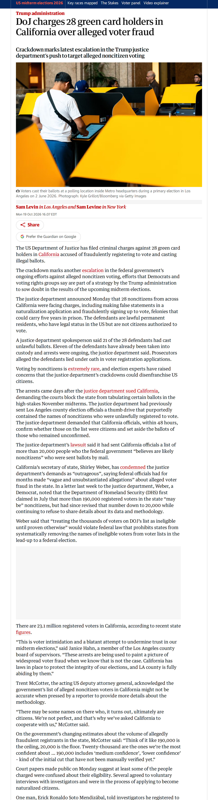

# Digital Arrest Scams 2.0: New Tactics Fraudsters Are Using in 2026

## Before you render

1. Read `english.txt` (and `roman_urdu.txt`). Rewrite anything that sounds off; keep it 45–60 seconds.
2. Replace every `{VERIFY: ...}` with a checked fact (rendering refuses to start while one is left).
3. Check each screenshot in `evidence/` and the quotes in `[article N "..."]` tags (copy them exactly from the article text below).
4. Optional: add your voice-over as `audio/english.mp3` / `audio/roman_urdu.mp3`.
5. Run **Generate Whiteboard Video** with `topic_dir` = `input/topics/2026-10-20-digital-arrest-scams-2-0-new`.

## Tags you can use

- `[news]` headline cards
- `[article N "exact words"]` article screenshot with those words highlighted
- `[chart ID 2021]` data chart with a marker on a date
- `[logo "Name"]` organisation logo
- `[icon house]` force a doodle (house, bank, document, money_bag, rate_badge, lock, car, …)

## Check these

- english: removed [chart 1]: series not downloaded
- english: article 2: quote not on the page, highlight removed: 'Suspected cybercrime can be reported through the official National Cyber Crime Reporting Portal at www.cybercrime.gov.in or by calling 1930 for financial cyber fraud assistance.'
- english: removed [chart 2]: series not downloaded

Placeholders to fill: **0**

## Evidence

### Article 1: DoJ charges 28 green card holders in California over alleged voter fraud | Trump administration
The Guardian — https://www.theguardian.com/us-news/2026/oct/19/california-illegal-voting-charges-doj

Sentences you can quote:

- The US Department of Justice has filed criminal charges against 28 green card holders in California accused of fraudulently registering to vote and casting illegal ballots.
- The justice department announced Monday that 28 noncitizens from across California were facing charges, including making false statements in a naturalization application and fraudulently signing up to vote, felonies that could carry five years in prison.
- A justice department spokesperson said 21 of the 28 defendants had cast unlawful ballots.
- The justice department demanded that California officials, within 48 hours, confirm whether those on the list were citizens and set aside the ballots of those who remained unconfirmed.
- The justice department’s lawsuit said it had sent California officials a list of more than 20,000 people who the federal government “believes are likely noncitizens” who were sent ballots by mail.
- There are 23.1 million registered voters in California, according to recent state figures.
- On the government’s changing estimates about the volume of allegedly fraudulent registrants in the state, McCotter said: “Think of it like 190,000 is the ceiling, 20,000 is the floor.
- Twenty-thousand are the ones we’re the most confident about … 190,000 includes ‘medium confidence’, ‘lower confidence’ – kind of the initial cut that have not been manually verified yet.”
- Mendizábal, who has been a legal permanent resident since 1976, told investigators he went with his wife to vote and was asked by poll workers if he wanted to cast a ballot.
- Investigators also claimed Soto had lied about being a citizen once before, in 1992, when he was trying to re-enter the country from Mexico.
- Another person who was charged, José Probitsado Amaro, has been a legal permanent resident since 1993, according to court documents.
- He told investigators he could not recall registering to vote, but acknowledged receiving a ballot in 2024 (California automatically sends every registered voter a mail-in ballot).
- Another person charged is a 61-year-old Tongan national who has been a legal permanent resident since 1969.
- Prosecutors say he registered and voted in 2024 and then applied for citizenship this year.

### Article 2: Advocate Nakul Manuja Raises Awareness on Digital Arrest Scams and Ways to Protect Your Rights
Hindustan Metro — https://hindustanmetro.com/advocate-nakul-manuja-digital-arrest-scams-awareness-legal-rights

Sentences you can quote:

- Suspected cybercrime can be reported through the official National Cyber Crime Reporting Portal at www.cybercrime.gov.in or by calling 1930 for financial cyber fraud assistance.
- Digital arrest scams have emerged as a serious concern in India, with fraudsters impersonating police officers, investigating agencies, and other government officials to intimidate people into transferring money or disclosing sensitive financial information.
- Public awareness and timely action are essential to preventing such fraud.
- In a typical digital arrest scam, victims receive calls or video calls alleging their involvement in criminal activities, money laundering, or suspicious transactions.
- Fraudsters may display fake identity cards, fabricated documents, or staged police environments to create an appearance of authority.
- They may threaten immediate arrest, insist on continuous video surveillance, or demand money under the pretext of verification or clearance.
- The most important message is simple: Do not panic, and do not transfer money under pressure.
- A threatening phone call or video call does not, by itself, establish that a person is under arrest.
- Intimidation over a video call is not a substitute for lawful arrest or legal procedure.
- To protect themselves, individuals should independently verify the caller’s identity through official government or law-enforcement channels.
- They should never share OTPs, passwords, banking credentials, or screen-sharing access with unknown callers.
- Any demand to transfer money to avoid arrest or settle an alleged criminal case should be treated as a serious warning sign.
- If someone encounters a suspected digital arrest scam, they should end the suspicious communication, preserve call records, messages, phone numbers, screenshots, and transaction details, and promptly inform their bank if money has been transferred.
- Prompt reporting may help authorities take timely action, although recovery of funds cannot be guaranteed.

### Logo: US Department of Justice
https://en.wikipedia.org/wiki/United_States_Department_of_Justice

### Logo: National Cyber Crime Reporting Portal
https://en.wikipedia.org/wiki/Indian_Cyber_Crime_Coordination_Centre

### Headline cards

