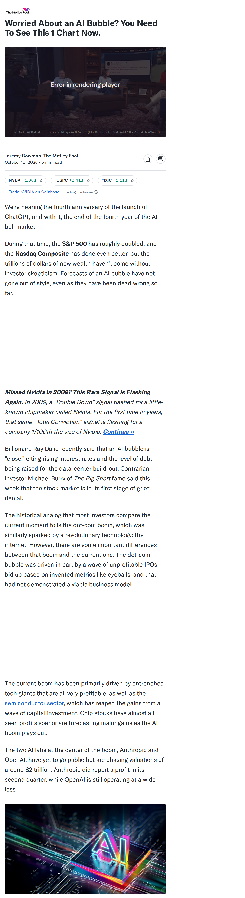
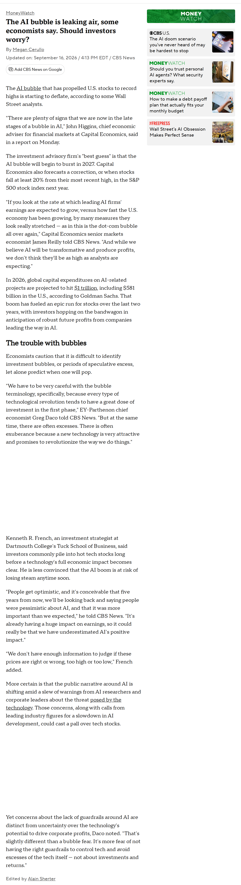
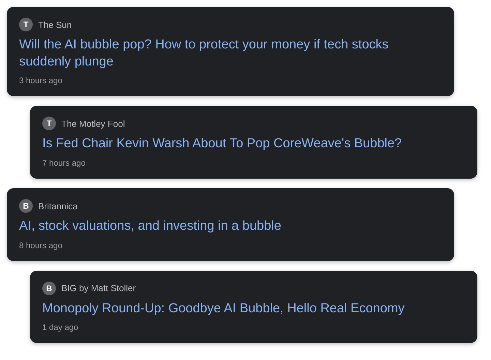

# Is the AI Stock Bubble About to Pop?

## Before you render

1. Read `english.txt` (and `roman_urdu.txt`). Rewrite anything that sounds off; keep it 45–60 seconds.
2. Replace every `{VERIFY: ...}` with a checked fact (rendering refuses to start while one is left).
3. Check each screenshot in `evidence/` and the quotes in `[article N "..."]` tags (copy them exactly from the article text below).
4. Optional: add your voice-over as `audio/english.mp3` / `audio/roman_urdu.mp3`.
5. Run **Generate Whiteboard Video** with `topic_dir` = `input/topics/2026-10-20-is-ai-stock-bubble-about-to`.

## Tags you can use

- `[news]` headline cards
- `[article N "exact words"]` article screenshot with those words highlighted
- `[chart ID 2021]` data chart with a marker on a date
- `[logo "Name"]` organisation logo
- `[icon house]` force a doodle (house, bank, document, money_bag, rate_badge, lock, car, …)

Placeholders to fill: **0**

## Evidence

### Article 1: Worried About an AI Bubble? You Need To See This 1 Chart Now.
Yahoo Finance — https://finance.yahoo.com/technology/ai/articles/worried-ai-bubble-see-1-130501202.html

Sentences you can quote:

- During that time, the S&P 500 has roughly doubled, and the Nasdaq Composite has done even better, but the trillions of dollars of new wealth haven't come without investor skepticism.
- In 2009, a "Double Down" signal flashed for a little-known chipmaker called Nvidia.
- For the first time in years, that same "Total Conviction" signal is flashing for a company 1/100th the size of Nvidia.
- The two AI labs at the center of the boom, Anthropic and OpenAI, have yet to go public but are chasing valuations of around $2 trillion.
- Instead of comparing the recent semiconductor boom to the dot-com era, the growth of the personal computer (PC) since its invention in the 1970s may be more informative.
- Computing technology will continue to improve, as it has over the past 50 years, and that should help sustain the AI boom, even amid the threat of economic cycles.
- The Motley Fool Stock Advisor analyst team just identified what they believe are the 10 best stocks for investors to buy now… and VanEck ETF Trust - VanEck Semiconductor ETF wasn't one of them.
- The 10 stocks that made the cut could produce monster returns in the coming years.
- Consider when Netflix made this list on December 17, 2004...
- if you invested $1,000 at the time of our recommendation, you'd have $379,123!* Or when Nvidia made this list on April 15, 2005...
- if you invested $1,000 at the time of our recommendation, you'd have $1,408,822!*
- Now, it's worth noting Stock Advisor's total average return is 950% — a market-crushing outperformance compared to 215% for the S&P 500.
- Don't miss the latest top 10 list, available with Stock Advisor, and join an investing community built by individual investors for individual investors.
- Yahoo Finance is not a broker-dealer or investment adviser and does not offer securities or cryptocurrencies for sale or facilitate trading.

### Article 2: The AI bubble is leaking air, some economists say. Should investors worry?
CBS News — https://www.cbsnews.com/news/ai-bubble-stocks-investors/

Sentences you can quote:

- The investment advisory firm's "best guess" is that the AI bubble will begin to burst in 2027.
- Capital Economics also forecasts a correction, or when stocks fall at least 20% from their most recent high, in the S&P 500 stock index next year.
- In 2026, global capital expenditures on AI-related projects are projected to hit $1 trillion, including $581 billion in the U.S., according to Goldman Sachs.
- stocks to record highs is starting to deflate, according to some Wall Street analysts.
- "There are plenty of signs that we are now in the late stages of a bubble in AI," John Higgins, chief economic adviser for financial markets at Capital Economics, said in a report on Monday.
- "If you look at the rate at which leading AI firms' earnings are expected to grow, versus how fast the U.S.
- economy has been growing, by many measures they look really stretched — as in this is the dot-com bubble all over again," Capital Economics senior markets economist James Reilly told CBS News.
- "And while we believe AI will be transformative and produce profits, we don't think they'll be as high as analysts are expecting."
- That boom has fueled an epic run for stocks over the last two years, with investors hopping on the bandwagon in anticipation of robust future profits from companies leading the way in AI.
- Economists caution that it is difficult to identify investment bubbles, or periods of speculative excess, let alone predict when one will pop.
- "We have to be very careful with the bubble terminology, specifically, because every type of technological revolution tends to have a great dose of investment in the first phase," EY-Parthenon chief economist Greg Daco told CBS News.
- "But at the same time, there are often excesses.
- There is often exuberance because a new technology is very attractive and promises to revolutionize the way we do things."
- French, an investment strategist at Dartmouth College's Tuck School of Business, said investors commonly pile into hot tech stocks long before a technology's full economic impact becomes clear.

### Chart FEDFUNDS: Federal Funds Effective Rate
Board of Governors of the Federal Reserve System via FRED — https://fred.stlouisfed.org/series/FEDFUNDS
Values: 2018-10-01: 2.19%; 2020-04-01: 0.05%; 2023-08-01: 5.33%; 2026-09-01: 3.75%

### Chart CPIAUCSL: Inflation: Consumer Prices, Percent Change from a Year Ago
U.S. Bureau of Labor Statistics via FRED — https://fred.stlouisfed.org/series/CPIAUCSL
Values: 2018-10-01: 2.49%; 2020-05-01: 0.20%; 2022-06-01: 8.98%; 2026-09-01: 3.72%

### Headline cards

