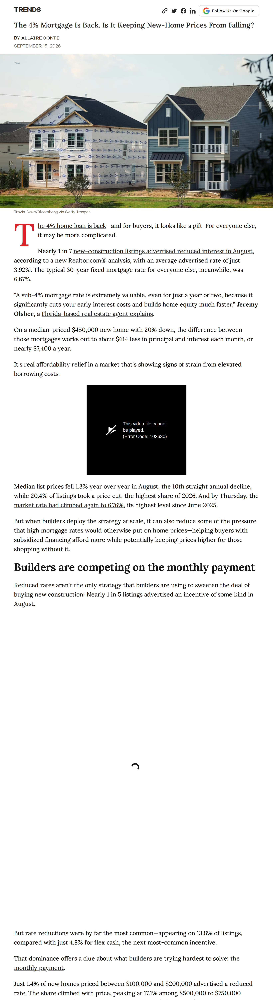
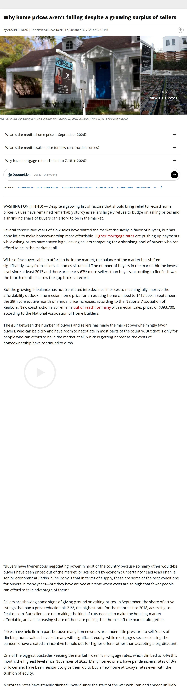
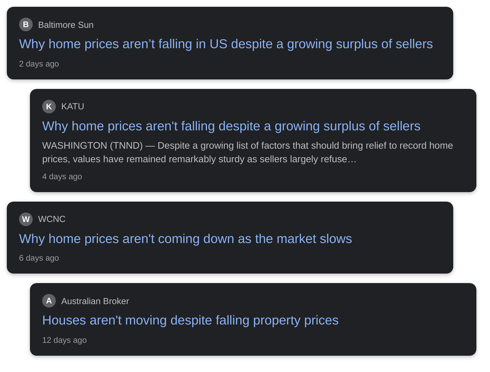

# why aren't home prices falling in america ?

## Before you render

1. Read `english.txt` (and `urdu.txt` / `roman_urdu.txt`). Rewrite anything that sounds off; keep it 45–60 seconds.
2. Replace every `{VERIFY: ...}` with a checked fact (rendering refuses to start while one is left).
3. Check each screenshot in `evidence/` and the quotes in `[article N "..."]` tags (copy them exactly from the article text below).
4. Optional: add your voice-over as `audio/english.mp3` / `audio/urdu.mp3`.
5. Run **Generate Whiteboard Video** with `topic_dir` = `input/topics/2026-10-21-aren-t-home-prices-falling-in`.

## Tags you can use

- `[news]` headline cards
- `[article N "exact words"]` article screenshot with those words highlighted
- `[chart ID 2021]` data chart with a marker on a date
- `[logo "Name"]` organisation logo
- `[icon oil-drum]` a drawing on the next word: any Fluent Emoji name (oil-drum, fuel-pump, mobile-phone, pill, house, …, see icon-sets.iconify.design/fluent-emoji-flat) or a doodle (house, bank, document, money_bag, rate_badge, lock, …)

## Check these

- english: [icon man] -> homes

Placeholders to fill: **0**

## Evidence

### Article 1: The 4% Mortgage Is Back. Is It Keeping New-Home Prices From Falling?
Realtor.com — https://www.realtor.com/news/trends/builder-mortgage-rates-new-home-incentives-2026/

Sentences you can quote:

- The 4% home loan is back—and for buyers, it looks like a gift.
- Nearly 1 in 7 new-construction listings advertised reduced interest in August, according to a new Realtor.com® analysis, with an average advertised rate of just 3.92%.
- The typical 30-year fixed mortgage rate for everyone else, meanwhile, was 6.67%.
- On a median-priced $450,000 new home with 20% down, the difference between those mortgages works out to about $614 less in principal and interest each month, or nearly $7,400 a year.
- Median list prices fell 1.3% year over year in August, the 10th straight annual decline, while 20.4% of listings took a price cut, the highest share of 2026.
- And by Thursday, the market rate had climbed again to 6.76%, its highest level since June 2025.
- Reduced rates aren't the only strategy that builders are using to sweeten the deal of buying new construction: Nearly 1 in 5 listings advertised an incentive of some kind in August.
- But rate reductions were by far the most common—appearing on 13.8% of listings, compared with just 4.8% for flex cash, the next most-common incentive.
- Just 1.4% of new homes priced between $100,000 and $200,000 advertised a reduced rate.
- The share climbed with price, peaking at 17.1% among $500,000 to $750,000 homes, followed by 15.8% among those priced from $750,000 to $1 million.
- Nearly 88% of existing-home owners with mortgages still have a rate below 6%, and the report notes a reduced builder rate may help overcome the “psychological hurdle” of giving that up.
- In San Antonio, TX, where the median new-construction listing price is about $330,000, reduced rates cluster in the $350,000 to $500,000 range.
- In Denver, where the median is nearly $639,000, they cluster in the $500,000 to $1 million range.
- Lennar reported that sales incentives (including primarily price discounts and financing incentives) averaged $62,700 per home in fiscal 2025, or 13.8% of home-sale revenue.

### Article 2: Why home prices aren't falling despite a growing surplus of sellers
KATU — https://katu.com/news/nation-world/why-home-prices-arent-falling-despite-a-growing-surplus-of-sellers

Sentences you can quote:

- The number of buyers in the market hit the lowest level since at least 2013 and there are nearly 63% more sellers than buyers, according to Redfin.
- The median home price for an existing home climbed to $417,500 in September, the 39th consecutive month of annual price increases, according to the National Association of Realtors.
- New construction also remains out of reach for many with median sales prices of $393,700, according to the National Association of Home Builders.
- In September, the share of active listings that had a price reduction hit 21%, the highest rate for the month since 2018, according to Realtor.com.
- One of the biggest obstacles keeping the market frozen is mortgage rates, which climbed to 7.4% this month, the highest level since November of 2023.
- Many homeowners have pandemic-era rates of 3% or lower and have been hesitant to give them up to buy a new home at today’s rates even with the cushion of equity.
- The yield on 10-year Treasurys, which mortgage rates tend to track, has soared to levels not seen since the financial crisis amid concerns about stubborn inflation and mounting levels of government debt.
- The typical new home buyer’s monthly payment has climbed 5% compared to last year to $3,037, according to Zillow.
- Construction of new single-family homes is down nearly 5% in 2026 as builders face higher rates, rising construction costs, labor shortages and an iffy housing market that is forcing them to offer discounts and other incentives to move inventory.
- WASHINGTON (TNND) — Despite a growing list of factors that should bring relief to record home prices, values have remained remarkably sturdy as sellers largely refuse to budge on asking prices and a shrinking share of buyers can afford to be in the market.
- Several consecutive years of slow sales have shifted the market decisively in favor of buyers, but has done little to make homeownership more affordable.
- Higher mortgage rates are pushing up payments while asking prices have stayed high, leaving sellers competing for a shrinking pool of buyers who can afford to be in the market at all.
- With so few buyers able to afford to be in the market, the balance of the market has shifted significantly away from sellers as homes sit unsold.
- It was the fourth month in a row the gap broke a record.

### Chart MORTGAGE30US: 30-Year Fixed Rate Mortgage Average in the United States
Freddie Mac via FRED — https://fred.stlouisfed.org/series/MORTGAGE30US
Values: 2018-10-25: 4.86%; 2021-01-07: 2.65%; 2023-10-26: 7.79%; 2026-10-15: 7.40%

### Chart MSPUS: Median Sales Price of Houses Sold for the United States
U.S. Census Bureau and HUD via FRED — https://fred.stlouisfed.org/series/MSPUS
Values: 2018-10-01: $322,800; 2019-01-01: $313,000; 2022-10-01: $442,600; 2026-04-01: $410,700

### Headline cards

