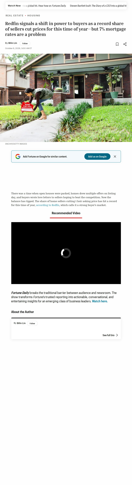
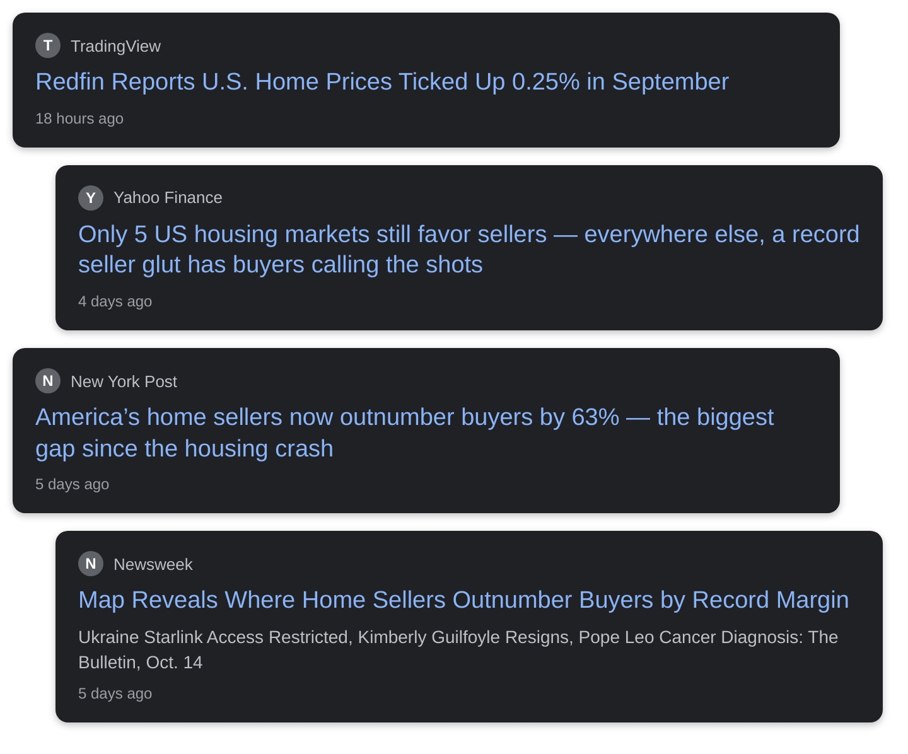

# strongest buyer's market home prices Redfin sellers

## Before you render

1. Read `english.txt` (and `urdu.txt` / `roman_urdu.txt`). Rewrite anything that sounds off; keep it 45–60 seconds.
2. Replace every `{VERIFY: ...}` with a checked fact (rendering refuses to start while one is left).
3. Check each screenshot in `evidence/` and the quotes in `[article N "..."]` tags (copy them exactly from the article text below).
4. Optional: add your voice-over as `audio/english.mp3` / `audio/urdu.mp3`.
5. Run **Generate Whiteboard Video** with `topic_dir` = `input/topics/2026-10-21-buyers-market-home-prices`.

## Tags you can use

- `[news]` headline cards
- `[article N "exact words"]` article screenshot with those words highlighted
- `[chart ID 2021]` data chart with a marker on a date
- `[logo "Name"]` organisation logo
- `[icon house]` force a doodle (house, bank, document, money_bag, rate_badge, lock, car, …)

## Check these

- english: [news] -> It's officially the strongest buyer's market in America on r
- english: [article 1 "According to Redfin, there were over 1.5 million sellers in"] -> In September, there were about one and a half million home s
- english: [article 1 "homebuyers by a record 63 percent as those discouraged by"] -> That's sixty-three percent more sellers than buyers.
- english: [article 1 "Redfin started tracking data in 2013, down to about 928,892."] -> According to Redfin, it's the biggest gap since they started

Placeholders to fill: **0**

## Evidence

### Article 1: Map Reveals Where Home Sellers Outnumber Buyers by Record Margin
Newsweek — https://www.newsweek.com/map-reveals-where-home-sellers-outnumber-buyers-by-record-margin-12571092

Sentences you can quote:

- Christiane Amanpour Announces She Is Leaving CNN After 43 Years
- Sellers now outnumber homebuyers by a record 63 percent as those discouraged by rising mortgage rates and lingering economic fears have backed off the market, according to the latest data.
- The buyer count last month fell to its lowest level since real estate brokerage Redfin started tracking data in 2013, down to about 928,892.
- That number was down 2.4 percent from the month before.
- At the same time, sellers hit their highest level since March 2020, when a pandemic homebuying frenzy triggered by historically low borrowing costs took over the country.
- According to Redfin, there were over 1.5 million sellers in the U.S.
- housing market in September across all residential property types, up 1.2 percent month-over-month.
- Americans, however, are in better homebuying shape than during the crash in 2008.
- In August, sellers outnumbered buyers by 56.9 percent, which means that the gap grew by nearly 6 percent in just one month.
- At the end of last year, housing experts and economists expected lower mortgage rates through 2026 to improve housing affordability for Americans.
- and Israel launched joint strikes in Iran at the end of February, the average 30-year fixed-rate mortgage—the most popular form of home loan among American borrowers—reached 5.98 percent, according to Freddie Mac.
- As of the week ending October 8, the 30-year fixed-rate mortgage averaged 7.4 percent, up from 6.30 percent a year earlier.
- Forty-one of the 50 most populous metropolitan areas in the nation are now technically “buyer’s markets”—ones where buyers appear to have the upper hand over sellers and can negotiate better deals for themselves.
- Normally, Redfin defines a buyer’s market as one where there are over 10 percent more sellers than buyers.

### Article 2: Redfin signals a shift in power to buyers amid price cuts—but 7% mortgage rates are a problem
Fortune — https://fortune.com/2026/10/06/redfin-power-shift-buyers-housing-market-price-cuts-listings-mortgage-rates/

Sentences you can quote:

- Steven Bartlett built The Diary of a CEO into a global hit.
- Steven Bartlett built The Diary of a CEO into a global hit.
- Steven Bartlett built The Diary of a CEO into a global hit.
- Steven Bartlett built The Diary of a CEO into a global hit.
- There was a time when open houses were packed, homes drew multiple offers on listing day, and buyers wrote love letters to sellers hoping to beat the competition.
- The share of home sellers cutting t heir asking price has hit a record for this time of year, according to Redfin, which calls it a strong buyer’s market.
- Use of this site constitutes acceptance of our Terms of Use and Privacy Policy | CA Notice at Collection and Privacy Notice | Do Not Sell/Share My Personal Information FORTUNE is a trademark of Fortune Media IP Limited, registered in the U.S.
- FORTUNE may receive compensation for some links to products and services on this website.
- Offers may be subject to change without notice.

### Chart ACTLISCOUUS: Housing Inventory: Active Listing Count in the United States
Realtor.com via FRED — https://fred.stlouisfed.org/series/ACTLISCOUUS
Values: 2018-10-01: $1,304,696; 2022-02-01: $346,515; 2026-09-01: $1,161,615

### Chart MORTGAGE30US: 30-Year Fixed Rate Mortgage Average in the United States
Freddie Mac via FRED — https://fred.stlouisfed.org/series/MORTGAGE30US
Values: 2018-10-25: 4.86%; 2021-01-07: 2.65%; 2023-10-26: 7.79%; 2026-10-15: 7.40%

### Headline cards

