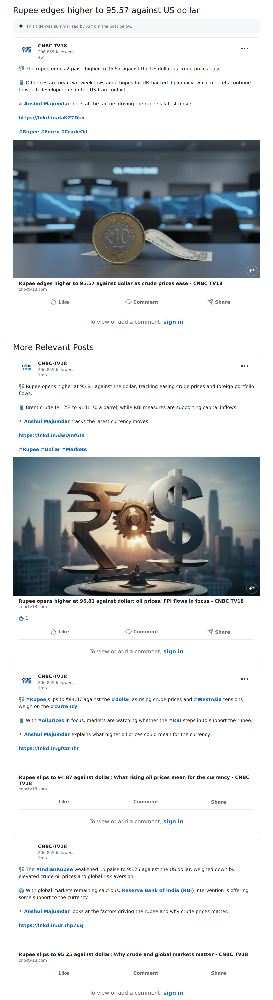
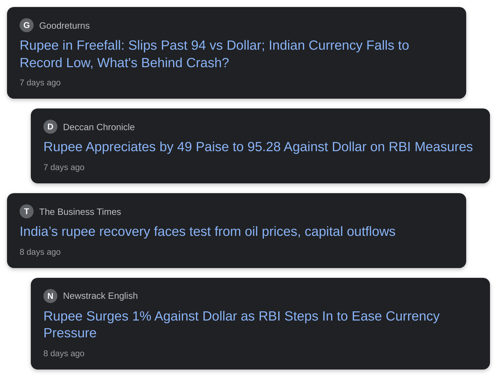

# rupee record low against dollar oil prices

## Before you render

1. Read `english.txt` (and `urdu.txt` / `roman_urdu.txt`). Rewrite anything that sounds off; keep it 45–60 seconds.
2. Replace every `{VERIFY: ...}` with a checked fact (rendering refuses to start while one is left).
3. Check each screenshot in `evidence/` and the quotes in `[article N "..."]` tags (copy them exactly from the article text below).
4. Optional: add your voice-over as `audio/english.mp3` / `audio/urdu.mp3`.
5. Run **Generate Whiteboard Video** with `topic_dir` = `input/topics/2026-10-21-dollar-mehnga-kyun`.

## Tags you can use

- `[news]` headline cards
- `[article N "exact words"]` article screenshot with those words highlighted
- `[chart ID 2021]` data chart with a marker on a date
- `[logo "Name"]` organisation logo
- `[icon oil-drum]` a drawing on the next word: any Fluent Emoji name (oil-drum, fuel-pump, mobile-phone, pill, house, …, see icon-sets.iconify.design/fluent-emoji-flat) or a doodle (house, bank, document, money_bag, rate_badge, lock, …)

## Check these

- urdu: meaning match 0.00 (chosen by qwen2.5:7b): [article 2 "✍️ Anshul Majumdar looks at the factors driving 
- urdu: meaning match 0.05 (chosen by qwen2.5:7b): [article 1 "The move comes as the rupee remains under pressu
- urdu: meaning match 0.02 (chosen by qwen2.5:7b): [chart DCOILBRENTEU 2026-10-14]
- urdu: meaning match 0.21 (chosen by qwen2.5:7b): [article 1 "The currency’s weakness has kept pressure on pol
- urdu: [news] -> ڈالر مہنگا کیوں ہوتا ہے؟
- urdu: [chart DEXINUS 2026-10-16] -> اس سال بھارتی روپیہ تاریخ کی سب سے نچلی سطح پر پہنچا، تقریبا
- urdu: [article 2 "✍️ Anshul Majumdar looks at the factors driving the rupee"] -> لیکن آخر ڈالر مہنگا ہوتا کیوں ہے؟
- urdu: [article 1 "The move comes as the rupee remains under pressure despite"] -> جب ڈالر کی مانگ زیادہ ہو اور ڈالر کم ہوں، تو ڈالر مہنگا ہو ج
- urdu: [chart DCOILBRENTEU 2026-10-14] -> اسی سال تیل کی قیمت بڑھنے سے بھارتی روپیہ ریکارڈ حد تک گرا۔
- urdu: [chart DCOILBRENTEU 2026-10-14] -> پیٹرول، موبائل فون، دوائیں، یہاں تک کہ کھانے کا تیل، سب مہنگ
- urdu: [article 1 "The currency’s weakness has kept pressure on policymakers as India"] -> ڈالر کی قیمت ہم کنٹرول نہیں کر سکتے۔

Placeholders to fill: **0**

## Evidence

### Article 1: India Moves to Support Rupee as Currency Nears Record Low Against US Dollar
Sada Elbalad English — https://see.news/india-moves-to-support-rupee-as-currency-nears-record-low-against-us-dollar

Sentences you can quote:

- The maximum position limit has been cut to $5 million from the previous $100 million.
- The RBI also directed market participants to maintain a foreign-exchange risk reserve equivalent to 20% of the notional value of every rupee-linked derivatives contract.
- The Indian rupee closed at 96.73 against the US dollar on Friday, little changed from the previous session but still close to its record low of 96.96 per dollar, reached in May.
- The Reserve Bank of India (RBI) announced additional measures to support the rupee as the currency approaches its record low against the US dollar, stepping up efforts to ease pressure on the foreign-exchange market.
- RBI said on Saturday it would establish a special facility to meet the daily dollar requirements of three state-owned oil marketing companies, aiming to reduce pressure on the spot foreign-exchange market.
- Under the arrangement, which can be used during periods of currency-market stress, the central bank will supply dollars directly from its foreign-exchange reserves to Indian Oil Corporation, Hindustan Petroleum Corporation and Bharat Petroleum Corporation.
- The facility is scheduled to become available on Monday.
- The move comes as the rupee remains under pressure despite previous central bank interventions, including dollar sales and an increase in the benchmark interest rate.
- Alongside the dollar facility, the RBI announced restrictions targeting foreign-exchange derivatives trading in an effort to curb speculative activity and ease pressure on the rupee.
- The central bank prohibited foreign-exchange market participants from rebooking any foreign-currency derivative contracts, while sharply reducing the permitted limit on positions in exchange-traded rupee-linked currency derivatives.
- The measures reflect the central bank’s efforts to manage currency-market volatility through tighter trading restrictions and direct access to dollar liquidity for major oil importers.
- The currency’s weakness has kept pressure on policymakers as India seeks to limit volatility in the foreign-exchange market.
- The RBI’s latest intervention focuses on oil marketing companies, whose dollar requirements are linked to payments for imported crude and other energy supplies.
- Meeting part of their daily dollar demand directly through the central bank could reduce their immediate need to purchase foreign currency in the spot market.

### Article 2: Rupee edges higher to 95.57 against dollar as crude prices ease - CNBC TV18
LinkedIn — https://www.linkedin.com/posts/cnbc-tv18_rupee-edges-higher-to-9557-against-dollar-activity-7508412042802888704-3d3e

Sentences you can quote:

- 💱 The rupee edges 2 paise higher to 95.57 against the US dollar as crude prices ease.
- https://lnkd.in/daKZ7Dkn #Rupee #Forex #CrudeOil
- 💱 Rupee opens higher at 95.81 against the dollar, tracking easing crude prices and foreign portfolio flows.
- 🛢️ Brent crude fell 2% to $101.70 a barrel, while RBI measures are supporting capital inflows.
- https://lnkd.in/dwDmf6Ts #Rupee #Dollar #Markets
- 💱 #Rupee slips to ₹94.87 against the #dollar as rising crude prices and #WestAsia tensions weigh on the #currency.
- 💱 The #IndianRupee weakened 15 paise to 95.25 against the US dollar, weighed down by elevated crude oil prices and global risk aversion.
- 📈 #Nifty holds above 24,000 as rupee hits a 2-month high.
- #RupeeCheck | The #rupee opened lower at 95.54 against dollar.
- #USDINR #ForexMarket #IndianRupee https://lnkd.in/eC8asN4b
- 📉 Indian equities end lower as the Nifty snaps a four-session winning run, falling 85 points to 23,329.
- 💱 Indian rupee gains 22 paise to open at ₹95.71 against the US dollar.
- 📉 Retreating crude oil prices and expected foreign inflows from the $2.3-billion NSE IPO supported the currency.
- The #rupee traded in a tight range around 90.35 per dollar, supported by RBI intervention, even as global risk aversion and India–US trade uncertainty capped gains in early trade.

### Chart DEXINUS: Indian Rupees to One U.S. Dollar (exchange rate)
Board of Governors of the Federal Reserve System via FRED — https://fred.stlouisfed.org/series/DEXINUS
Values: 2018-10-23: $73.54; 2019-07-11: $68.40; 2026-10-07: $96.76; 2026-10-16: $94.96

### Chart DCOILBRENTEU: Crude Oil Prices: Brent, dollars per barrel
U.S. Energy Information Administration via FRED — https://fred.stlouisfed.org/series/DCOILBRENTEU
Values: 2018-10-23: $78.67; 2020-03-31: $14.85; 2026-09-15: $131; 2026-10-14: $127

### Headline cards

