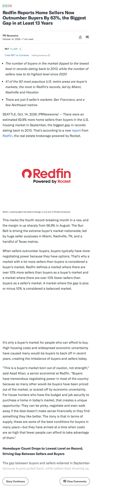
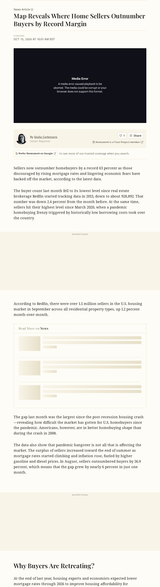
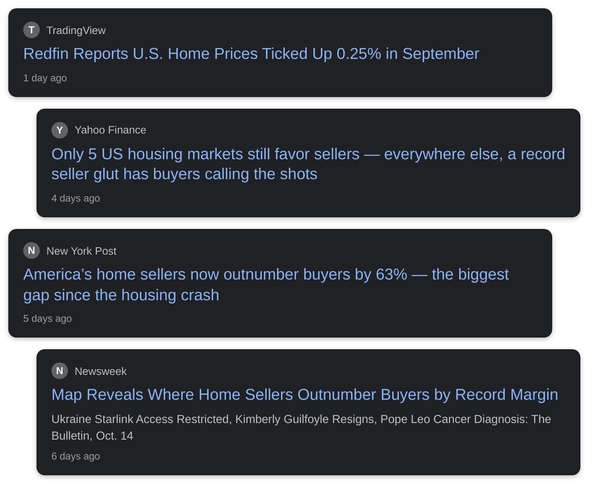

# strongest buyer's market home prices Redfin sellers

## Before you render

1. Read `english.txt` (and `urdu.txt` / `roman_urdu.txt`). Rewrite anything that sounds off; keep it 45–60 seconds.
2. Replace every `{VERIFY: ...}` with a checked fact (rendering refuses to start while one is left).
3. Check each screenshot in `evidence/` and the quotes in `[article N "..."]` tags (copy them exactly from the article text below).
4. Optional: add your voice-over as `audio/english.mp3` / `audio/urdu.mp3`.
5. Run **Generate Whiteboard Video** with `topic_dir` = `input/topics/EnglishNew`.

## Tags you can use

- `[news]` headline cards
- `[article N "exact words"]` article screenshot with those words highlighted
- `[chart ID 2021]` data chart with a marker on a date
- `[logo "Name"]` organisation logo
- `[icon oil-drum]` a drawing on the next word: any Fluent Emoji name (oil-drum, fuel-pump, mobile-phone, pill, house, …, see icon-sets.iconify.design/fluent-emoji-flat) or a doodle (house, bank, document, money_bag, rate_badge, lock, …)

## Check these

- english: meaning match 0.14 (chosen by qwen2.5:7b): [article 1 "That's why a market with a lot more sellers than
- english: meaning match 0.04 (chosen by qwen2.5:7b): [article 2 "housing market in September across all residenti
- english: meaning match 0.10 (chosen by qwen2.5:7b): [article 1 "When sellers outnumber buyers, buyers typically 
- english: [news] -> It’s officially the strongest buyer’s market in America on r
- english: [article 2 "According to Redfin, there were over 1.5 million sellers in"] -> In September, there were about one and a half million home s
- english: [article 2 "homebuyers by a record 63 percent as those discouraged by"] -> That’s sixty-three percent more sellers than buyers.
- english: [article 2 "Redfin started tracking data in 2013, down to about 928,892."] -> According to Redfin, it’s the biggest gap since they started
- english: [article 1 "That's why a market with a lot more sellers than"] -> Basic economics says too many sellers should push prices dow
- english: [article 2 "housing market in September across all residential property types, up"] -> The typical existing home sold for about four hundred sevent
- english: [article 1 "For house hunters who have the budget and job security"] -> So when the offers are too low, they simply say no, and take
- english: [article 1 "When sellers outnumber buyers, buyers typically have more negotiating power"] -> Sellers aren’t desperate.
- english: [icon house] -> four hundred seventeen thousand dollars
- english: [icon house] -> four out of ten
- english: [icon receipt] -> no monthly payment
- english: [icon piata] -> take the house off the market
- english: [icon man] -> nearly forty-five thousand
- english: [icon department-store] -> shop

Placeholders to fill: **0**

## Evidence

### Article 1: Redfin Reports Home Sellers Now Outnumber Buyers By 63%, the Biggest Gap in at Least 13 Years
Yahoo Finance — https://finance.yahoo.com/real-estate/articles/redfin-reports-home-sellers-now-120000869.html

Sentences you can quote:

- The number of buyers in the market dipped to the lowest level in records dating back to 2013, while the number of sellers rose to its highest level since 2020
- There are just 5 seller's markets: San Francisco, and a few Northeast metros
- 14, 2026 /PRNewswire/ -- There were an estimated 62.6% more home sellers than buyers in the U.S.
- housing market in September, the biggest gap in records dating back to 2013.
- This marks the fourth record-breaking month in a row, and the margin is up sharply from 56.9% in August.
- Redfin defines a market where there are over 10% more sellers than buyers as a buyer's market and a market where there are over 10% fewer sellers than buyers as a seller's market.
- A market where the gap is plus or minus 10% is considered a balanced market.
- There were an estimated 928,892 homebuyers in the market nationwide in September, the lowest level in records dating back through 2013.
- That's down 2.4% from a month earlier, the fifth straight monthly decline.
- On the flip side, there were an estimated 1,510,784 home sellers in the market, the most since March 2020.
- That's the most in records dating back through 2013.
- In the top 13 buyer's markets, there were more than twice as many sellers as buyers in September.
- The surplus increased most in Miami, which also has the biggest surplus of sellers over buyers; there were 158.9% more sellers than buyers in September, up from 134.5% the month before.
- The next-biggest monthly increase was in Tampa, where there were 103.7% more sellers than buyers in September, up from 82.2% in August.

### Article 2: Map Reveals Where Home Sellers Outnumber Buyers by Record Margin
Newsweek — https://www.newsweek.com/map-reveals-where-home-sellers-outnumber-buyers-by-record-margin-12571092

Sentences you can quote:

- Sellers now outnumber homebuyers by a record 63 percent as those discouraged by rising mortgage rates and lingering economic fears have backed off the market, according to the latest data.
- The buyer count last month fell to its lowest level since real estate brokerage Redfin started tracking data in 2013, down to about 928,892.
- That number was down 2.4 percent from the month before.
- At the same time, sellers hit their highest level since March 2020, when a pandemic homebuying frenzy triggered by historically low borrowing costs took over the country.
- According to Redfin, there were over 1.5 million sellers in the U.S.
- housing market in September across all residential property types, up 1.2 percent month-over-month.
- Americans, however, are in better homebuying shape than during the crash in 2008.
- In August, sellers outnumbered buyers by 56.9 percent, which means that the gap grew by nearly 6 percent in just one month.
- At the end of last year, housing experts and economists expected lower mortgage rates through 2026 to improve housing affordability for Americans.
- and Israel launched joint strikes in Iran at the end of February, the average 30-year fixed-rate mortgage—the most popular form of home loan among American borrowers—reached 5.98 percent, according to Freddie Mac.
- As of the week ending October 8, the 30-year fixed-rate mortgage averaged 7.4 percent, up from 6.30 percent a year earlier.
- Forty-one of the 50 most populous metropolitan areas in the nation are now technically “buyer’s markets”—ones where buyers appear to have the upper hand over sellers and can negotiate better deals for themselves.
- Normally, Redfin defines a buyer’s market as one where there are over 10 percent more sellers than buyers.
- The biggest gap in the nation last month was in Miami, where buyers outnumbered sellers by 158.9 percent.

### Headline cards

